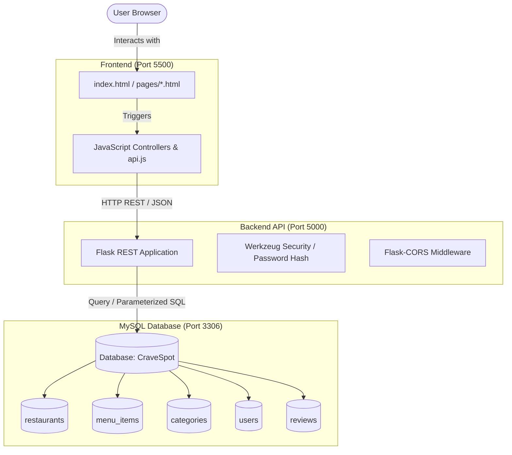

# 🍴 CraveSpot

### **The Ultimate Cheat-Meal & Street Food Finder**

> **Find what you're craving. Discover where to get it.**

CraveSpot is a food discovery web application designed to help users find dishes and restaurants based on their cravings. Instead of focusing solely on food delivery, CraveSpot centers on **discovering food, exploring categories, comparing options, and viewing rich restaurant and dish details**.

---

## 👥 Team — The Confluence

| Member | Role |
|---|---|
| **Harsh Garg** | Team Leader / Documentation |
| **Simran** | Frontend Development |
| **Taranpreet** | Frontend Development |
| **Anshita** | Backend Development |
| **Divya** | Backend Development |
| **Babishya** | Database Engineering |
| **Anshuman** | Database Engineering |
| **Majid** | Testing / QA |

**Project:** CraveSpot  
**Course:** B.Tech Computer Science & Engineering  
**Academic Year:** 2026  

---

## 📌 Problem Statement

Finding the right food can be overwhelming when a user knows what they crave but does not know which restaurant or dish to choose:
- Food options are fragmented across multiple platforms.
- Users know what food they want (e.g., Momos, Biryani, Pasta) but not where to find the best local options.
- Comparing dishes by price, rating, and dietary preferences (vegetarian vs. non-vegetarian) takes excessive effort.
- Most food platforms prioritize complex ordering pipelines rather than an intuitive food discovery experience.

### 💡 The CraveSpot Solution
**CraveSpot unifies local vendors, categorized menus, dietary filters, and location-based discovery into a clean, modern web interface.**

---

## ✨ Features

- 🔎 **Instant Food Search** — Search for dishes, cuisines, and restaurants from the homepage or dedicated search bars.
- 🍕 **Category Browsing** — Explore dishes by categories (Biryani, Pizza, Burger, Chinese, North Indian, Desserts, Fast Food, Beverages).
- 🍽️ **Dish Catalog & Details** — Browse popular dishes with ratings, prices, dietary tags (Veg/Non-Veg), ingredients, and full descriptions.
- 🏪 **Restaurant Directory** — Browse restaurants with average pricing, ratings, active discount offers, and multi-filter controls (ratings, veg-only, cuisines).
- 📍 **Location / City Selection** — Filter restaurants by city (Chandigarh, Mohali, Panchkula) and compute distance using geolocation coordinates.
- 🔐 **Authentication System** — Secure user registration and login with encrypted password storage (Werkzeug scrypt).
- ⭐ **Ratings & Reviews** — Submit and read reviews and ratings for each restaurant.
- ❤️ **Favorites** — Save favorite dishes and restaurants to browser storage.
- 📱 **Responsive UI** — Modern, mobile-friendly interface styled with CSS3 and SVG iconography.

---

## 🛠️ Technology Stack

### Frontend
- **HTML5 & CSS3** — Semantic structure and custom responsive styling.
- **JavaScript (ES6+)** — Client-side routing, DOM manipulation, asynchronous API communication (`fetch`).
- **Development Server** — Python `http.server` (zero Node.js dependencies required).

### Backend
- **Python 3.10+**
- **Flask** — Lightweight WSGI REST API framework.
- **Flask-CORS** — Cross-Origin Resource Sharing for seamless frontend-backend integration.
- **python-dotenv** — Environment configuration loader.
- **Werkzeug** — Cryptographic password hashing and verification.

### Database
- **MySQL Server 8.0+**
- **Database Name:** `CraveSpot`
- **Connector:** `mysql-connector-python`
- **Schema & Seeding:** `database/schema.sql` (idempotent DDL with constraints, indexes, foreign keys, and seed data).

---

## 🧩 Project Architecture



---

## 📂 Project Directory Structure

```text
CraveSpot_Complete/
│
├── .env                       # Local environment variables (DB credentials)
├── .env.example               # Template for environment variables
├── .gitignore                 # Protects .env, venv, and cache from Git
├── requirements.txt           # Python backend dependencies
├── init_db.py                 # Automated MySQL database setup script
├── setup.bat                  # One-click Windows setup script
├── run_backend.bat            # One-click Windows backend launcher
├── run_frontend.bat           # One-click Windows frontend launcher
│
├── backend/
│   └── app.py                 # Core Flask REST API application
│
├── database/
│   └── schema.sql             # SQL schema DDL, constraints, indexes & seed data
│
├── frontend/
│   ├── index.html             # Homepage / Landing page
│   ├── css/
│   │   ├── style.css          # Homepage styling
│   │   ├── categories.css     # Categories styling
│   │   ├── dishes.css         # Dishes catalog styling
│   │   ├── dish-details.css   # Dish detail styling
│   │   ├── restaurants.css    # Restaurant catalog styling
│   │   ├── details.css        # Restaurant details styling
│   │   └── login.css          # Auth styling
│   ├── js/
│   │   ├── api.js             # Central API request wrapper
│   │   ├── app.js             # Shared interactions & search
│   │   ├── categories.js      # Category page logic
│   │   ├── dishes.js          # Dish filtering & search logic
│   │   ├── dish-details.js    # Dish detail view logic
│   │   ├── restaurants.js     # Restaurant directory & filtering
│   │   ├── details.js         # Restaurant menu & review logic
│   │   ├── login.js           # Login form submission
│   │   └── register.js        # Registration form submission
│   ├── pages/
│   │   ├── categories.html
│   │   ├── dishes.html
│   │   ├── dish-details.html
│   │   ├── restaurant-details.html
│   │   ├── restaurants.html
│   │   ├── login.html
│   │   └── register.html
│   └── assets/
│       ├── icons/
│       └── images/
│
└── docs/                      # Project briefs, BRD, TRD, and architecture specs
```

---

## 🚀 Quick Start Guide (Windows 11)

### Prerequisites
1. **Python 3.10+** installed (with *"Add Python to PATH"* enabled during installation).
2. **MySQL Server 8.0+** installed and running on `localhost:3306`.
3. **MySQL Workbench** or command-line client.

---

### Step 1: Automated Environment Setup

Double-click `setup.bat` (or execute from terminal):

```cmd
setup.bat
```

This will automatically:
1. Verify Python is installed.
2. Create the Python virtual environment (`venv\`).
3. Install all required dependencies (`Flask`, `Flask-Cors`, `mysql-connector-python`, `python-dotenv`).
4. Generate `.env` from `.env.example` if not already present.
5. Offer to initialize the database immediately.

---

### Step 2: Configure Database Credentials

Open the generated `.env` file in your text editor and ensure the MySQL credentials match your local MySQL configuration:

```ini
DB_HOST=localhost
DB_PORT=3306
DB_USER=root
DB_PASSWORD=your_mysql_password_here
DB_NAME=CraveSpot

PORT=5000
DEBUG=False
CORS_ORIGINS=*
```

> **Note:** The database name is configured to `CraveSpot`.

---

### Step 3: Initialize the MySQL Database

You can initialize the database using either of the following two options:

#### Option A: Using the Automated Python Script (Recommended)
Run the initializer script using the virtual environment Python:
```cmd
venv\Scripts\python.exe init_db.py
```

#### Option B: Using MySQL Workbench
1. Open **MySQL Workbench** and connect to your local instance.
2. Go to **File → Open SQL Script...** and select `database\schema.sql`.
3. Click the ⚡ **Execute** button (Ctrl+Shift+Enter).
4. Refresh the Schemas navigator — you will see the `CraveSpot` database with 5 tables and seed data.

---

### Step 4: Start the Backend Server

Double-click `run_backend.bat`:

```cmd
run_backend.bat
```

- Backend URL: **http://127.0.0.1:5000**
- Health Check: **http://127.0.0.1:5000/api/health**

---

### Step 5: Start the Frontend Application

Double-click `run_frontend.bat`:

```cmd
run_frontend.bat
```

- The script starts a local web server on port **5500** and automatically opens your default browser at:
  **http://127.0.0.1:5500**

---

## 💻 Manual Setup (Alternative to Batch Scripts)

For PowerShell or Command Prompt users who prefer manual commands:

```powershell
# 1. Create and activate virtual environment
python -m venv venv
.\venv\Scripts\activate

# 2. Install dependencies
pip install -r requirements.txt

# 3. Create .env if missing
copy .env.example .env

# 4. Initialize database
python init_db.py

# 5. Start Backend (Terminal 1)
python backend/app.py

# 6. Start Frontend (Terminal 2)
python -m http.server 5500 --directory frontend
```

---

## 🗄️ Database Schema & Data Dictionary

Database: **`CraveSpot`**

### 1. `restaurants`
| Column | Type | Constraints | Description |
|---|---|---|---|
| `restaurant_id` | INT | PK, AUTO_INCREMENT | Unique restaurant identifier |
| `name` | VARCHAR(150) | NOT NULL | Restaurant / Vendor name |
| `cuisine` | VARCHAR(150) | NOT NULL | Cuisines served (comma/bullet separated) |
| `address` | VARCHAR(255) | NOT NULL | Physical address & city |
| `rating` | DECIMAL(2,1) | DEFAULT 0.0 | Average star rating (0.0 to 5.0) |
| `is_veg` | TINYINT(1) | DEFAULT 0 | 1 = Pure Vegetarian, 0 = Non-Veg / Mixed |
| `offer` | VARCHAR(100) | NULL | Current promotional offer (e.g. "20% OFF") |
| `image_url` | VARCHAR(500) | NULL | Restaurant display image URL |
| `latitude` | DECIMAL(10,8)| NULL | Geolocation latitude |
| `longitude`| DECIMAL(11,8)| NULL | Geolocation longitude |
| `created_at`| TIMESTAMP | DEFAULT CURRENT_TIMESTAMP | Record creation timestamp |
| `updated_at`| TIMESTAMP | ON UPDATE CURRENT_TIMESTAMP | Record modification timestamp |

### 2. `menu_items`
| Column | Type | Constraints | Description |
|---|---|---|---|
| `item_id` | INT | PK, AUTO_INCREMENT | Unique item identifier |
| `restaurant_id` | INT | FK -> `restaurants.restaurant_id` | Parent restaurant |
| `category_id` | INT | FK -> `categories.category_id` | Food category |
| `name` | VARCHAR(150) | NOT NULL | Name of dish / menu item |
| `category` | VARCHAR(100) | NULL | Category label |
| `description` | TEXT | NULL | Dish description |
| `price` | DECIMAL(10,2)| NOT NULL | Price in INR (₹) |
| `image_url` | VARCHAR(500) | NULL | Dish image URL |
| `is_veg` | TINYINT(1) | DEFAULT 0 | 1 = Vegetarian, 0 = Non-Veg |
| `rating` | DECIMAL(2,1) | DEFAULT 0.0 | Star rating |

### 3. `categories`
| Column | Type | Constraints | Description |
|---|---|---|---|
| `category_id` | INT | PK, AUTO_INCREMENT | Unique category identifier |
| `name` | VARCHAR(100) | NOT NULL, UNIQUE | Category name |
| `description` | TEXT | NULL | Short summary of category |
| `image_url` | VARCHAR(500) | NULL | Representative category image |

### 4. `users`
| Column | Type | Constraints | Description |
|---|---|---|---|
| `user_id` | INT | PK, AUTO_INCREMENT | Unique user identifier |
| `name` | VARCHAR(150) | NOT NULL | User's full name |
| `email` | VARCHAR(150) | NOT NULL, UNIQUE | User's email address |
| `password` | VARCHAR(255) | NOT NULL | Werkzeug scrypt-hashed password |
| `phone` | VARCHAR(20) | NULL | Contact phone number |

### 5. `reviews`
| Column | Type | Constraints | Description |
|---|---|---|---|
| `review_id` | INT | PK, AUTO_INCREMENT | Unique review identifier |
| `restaurant_id` | INT | FK -> `restaurants.restaurant_id` | Target restaurant |
| `user_id` | INT | FK -> `users.user_id` | Submitting user (optional) |
| `user_name` | VARCHAR(150) | NOT NULL | Display name of reviewer |
| `rating` | INT | CHECK (1 <= rating <= 5) | Star rating (1-5) |
| `comment` | TEXT | NULL | Review text feedback |

---

## 📡 REST API Reference

Base URL: `http://127.0.0.1:5000/api`

| Endpoint | Method | Params / Payload | Description |
|---|---|---|---|
| `/` | `GET` | None | API root status & version |
| `/api/health` | `GET` | None | MySQL database connectivity check |
| `/api/restaurants` | `GET` | `?search=`, `?cuisine=`, `?city=`, `?veg_only=`, `?min_rating=`, `?sort=` | List all restaurants with optional filters |
| `/api/restaurants/<id>` | `GET` | None | Get single restaurant details |
| `/api/restaurants/<id>/menu` | `GET` | None | Get menu items for specific restaurant |
| `/api/menu-items` *(or `/api/dishes`)* | `GET` | `?search=`, `?category=`, `?restaurant_id=`, `?veg_only=`, `?max_price=` | List menu items / dishes |
| `/api/menu-items/<id>` *(or `/api/dishes/<id>`)* | `GET` | None | Get single dish details with restaurant info |
| `/api/categories` | `GET` | None | List all food categories |
| `/api/restaurants/<id>/reviews` | `GET` | None | List customer reviews for restaurant |
| `/api/restaurants/<id>/reviews` | `POST` | `{"user_name": "...", "rating": 5, "comment": "..."}` | Submit new review |
| `/api/register` | `POST` | `{"name": "...", "email": "...", "password": "...", "phone": "..."}` | Register new account |
| `/api/login` | `POST` | `{"email": "...", "password": "..."}` | User login authentication |
| `/api/nearby-restaurants` | `POST` | `{"latitude": 30.7333, "longitude": 76.7794, "radius_km": 10}` | Geolocation search via Haversine formula |

---

## 🧪 Default Test Credentials

For quick testing of login and database functionality:
- **Email:** `demo@cravespot.com`
- **Password:** `Password123`

---

## 🛠️ Troubleshooting

### 1. Database Connection Failed (`Database connection failed: 2003 / Can't connect to MySQL server`)
- **Cause:** MySQL Server is stopped.
- **Fix:** Open Windows Services (`services.msc`), find **MySQL80** (or your MySQL service), right-click and click **Start**.

### 2. Access Denied for User 'root'@'localhost' (`Error 1045`)
- **Cause:** Incorrect MySQL password in `.env`.
- **Fix:** Open `.env` and verify `DB_PASSWORD=your_actual_password`. Save the file and restart the backend.

### 3. Unknown Database 'CraveSpot' (`Error 1049`)
- **Cause:** Database `CraveSpot` has not been initialized yet.
- **Fix:** Run `venv\Scripts\python.exe init_db.py` or run `database\schema.sql` in MySQL Workbench.

### 4. Port 5000 Already in Use
- **Cause:** Another application (or a previous instance of Flask) is using port 5000.
- **Fix:** Find and terminate the process holding port 5000:
  ```powershell
  Get-Process -Id (Get-NetTCPConnection -LocalPort 5000).OwningProcess | Stop-Process -Force
  ```
  Or change `PORT=5001` in `.env`.

### 5. Frontend Displays "Using sample restaurant data"
- **Cause:** Frontend cannot reach the Flask backend at `http://127.0.0.1:5000/api`.
- **Fix:** Ensure `run_backend.bat` is running in an active terminal window before interacting with the frontend.
