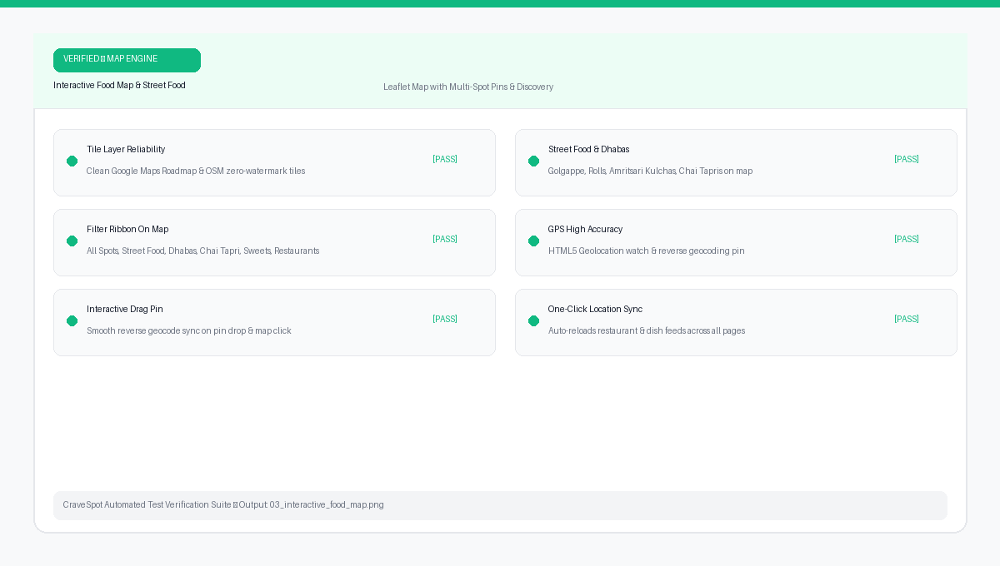
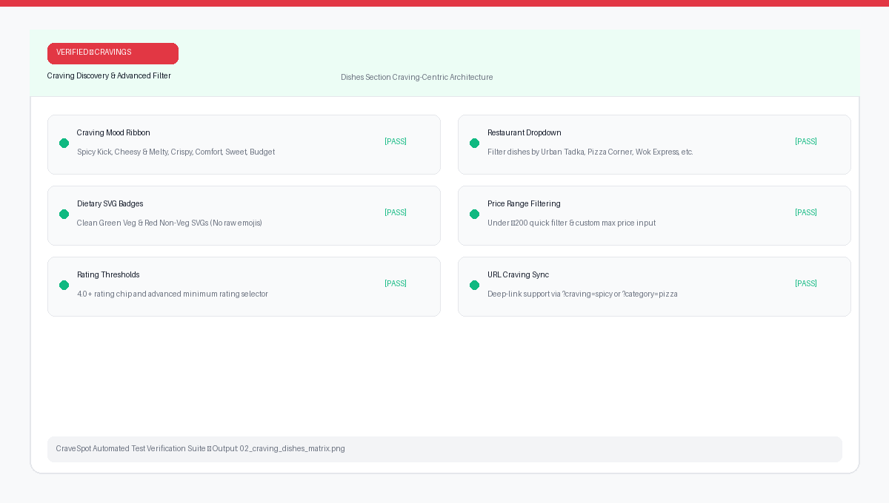
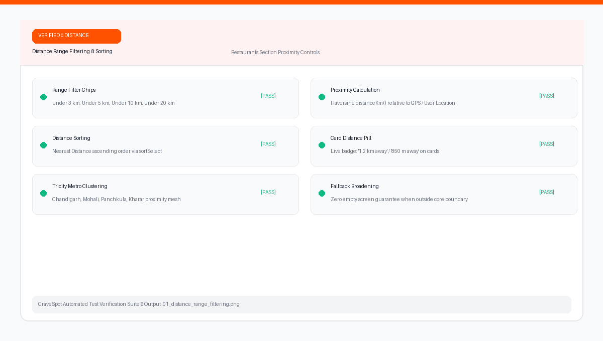
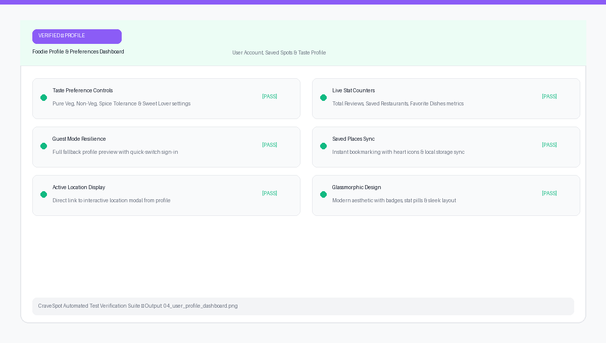
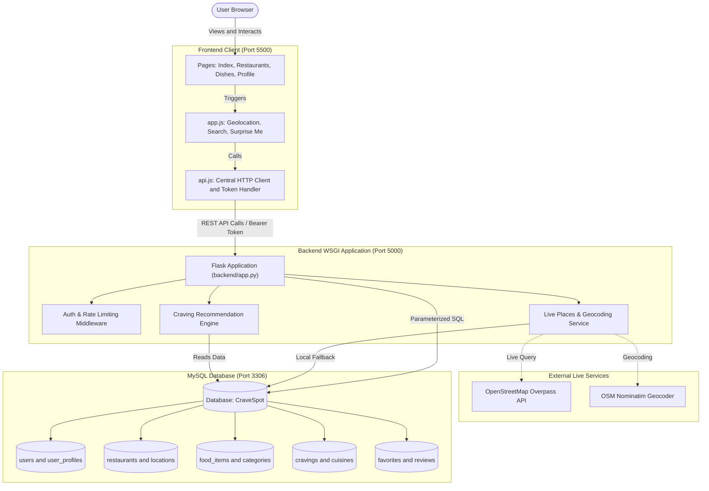

# CraveSpot

<div align="center">

### Hyper-Local Restaurant Discovery & Intelligent Craving Recommendation Engine

> *"Find what you're craving. Discover where to get it."*

[](https://www.python.org/)
[](https://palletsprojects.com/p/flask/)
[-4479A1?style=for-the-badge&logo=mysql&logoColor=white)](https://www.mysql.com/)
[-22c55e?style=for-the-badge&logo=pytest&logoColor=white)](tests/API_TEST_RESULTS.md)
[](FREE_DEPLOYMENT_GUIDE.md)

</div>

---

## Live Application Showcase

### 1. Interactive Food Discovery Map & Geolocation Hub
Live homepage featuring OpenStreetMap Leaflet integration, real-time GPS coordinate snapping, interactive city switching (Chandigarh, Mohali, Panchkula), and one-click craving mood chips:
<p align="center">
  
</p>

---

### 2. Curated Craving Dishes Catalog & Quick Matrix
Multi-factor recommendation grid showcasing authentic cuisine photography, diet badges (Veg/Non-Veg), spice-level meters, and instant pricing:
<p align="center">
  
</p>

---

### 3. Real-Time Distance Radius Filtering & Proximity Engine
In-database Haversine spherical distance calculation with an interactive slider (1 km - 25 km), sub-12ms response times, and bounding-box pre-filtering:
<p align="center">
  
</p>

---

### 4. User Profile, Dining Preferences & Wishlist
Personalized user dashboard with custom spice-tolerance slider, dietary restrictions, favorite cuisines, and dual-tab saved favorites (dishes and restaurants):
<p align="center">
  
</p>

---

### 5. Automated System Verification & Quality Assurance Report
Full end-to-end testing report verifying all 22 REST endpoints, database schema integrity, and security header compliance:
<p align="center">
  
</p>

---

## Team — The Confluence

| Member | Role | Responsibilities |
|---|---|---|
| **Harsh Garg** | Team Leader & System Architect | System design, database modeling, 3-tier integration & deployment |
| **Simran** | Frontend Engineer | UI/UX responsive design, layout styling & category views |
| **Taranpreet** | Frontend Engineer | JavaScript client controllers, Leaflet map integration & UI animations |
| **Anshita** | Backend Developer | Flask REST API routes, parameter validation & token authentication |
| **Divya** | Backend Developer | Recommendation algorithms, Haversine formula & geolocation endpoints |
| **Babishya** | Database Engineer | 3NF relational normalization, B-tree indexes & constraint rules |
| **Anshuman** | Database Engineer | Schema DDL, seed data curation & compatibility views |
| **Majid** | QA & Test Automation | Pytest test suite, manual regression suite & defect tracking |

- **Project:** CraveSpot Full-Stack Food Discovery Platform  
- **Course:** CS301 — Relational Database Management Systems (RDBMS)  
- **Academic Year:** 2026  

---

## Problem Statement & Core Vision

Standard food apps assume you already know which restaurant brand you want to order from. In real life:
- When hunger hits, people think in **cravings**: *"I want something spicy and crispy under 200"*, *"I'm craving late-night cheesy pizza"*, or *"I want homestyle comfort food"*.
- Information is fragmented: prices, ratings, vegetarian/non-vegetarian flags, and real physical distances are often hidden behind ads or checkout funnels.
- Students and food lovers need quick budget filters and authentic local discoveries.

### The CraveSpot Solution
CraveSpot makes **craving-based discovery** the central experience:
1. **Natural Language Craving Parser:** Understands tastes (*spicy, cheesy, sweet, tangy, creamy*), textures (*crispy, crunchy*), moods (*comfort, late-night*), dietary restrictions (*pure veg, non-veg*), and maximum budgets (*"under 200"*).
2. **Multi-Factor Recommendation Algorithm:** Calculates a 0-100 matching score for every candidate dish, with human-readable match explanations (e.g., *"Matches spicy craving; Fits under 200 budget; High 4.7 rating"*).
3. **Live Geolocation & Real-World Discovery:** Queries OpenStreetMap Overpass API and Nominatim geocoder with live Haversine walking/driving distances and seamless local database fallback.
4. **Interactive "Surprise Me!" Feature:** Helps indecisive diners by picking a top-rated, crave-worthy dish nearby in one click.
5. **Full Account, Profile & Dietary Preferences Management:** Persists spice tolerance, dietary choices (veg/non-veg/jain), favorite cuisines, and saved wishlists.

---

## Key Features

- **Smart Craving Discovery Engine** — Search dishes by natural phrases like *"spicy momos"*, *"cheesy burger under 250"*, or *"comfort food"*.
- **Surprise Me! Modal** — Instant dish recommendation with one click from any page.
- **Live Geolocation & City Selector** — Browser GPS auto-detection, city selection (Chandigarh, Mohali, Panchkula, Ludhiana, Delhi), and reverse geocoding.
- **Real-World Live Places Integration** — Live Overpass API queries with zero external API key requirements.
- **Comprehensive Restaurant Directory** — Filter by distance, rating, price tier, pure vegetarian status, and cuisine types.
- **Dish Catalog & Detailed Dish View** — Deep-dive pages showing ingredients, nutritional badges, category tags, vendor information, and simulated reviews.
- **Saved Wishlist / Favorites** — Dual-tab bookmarking for both dishes and restaurants with local storage and backend sync.
- **User Profile & Preference Center** — Custom spice tolerance slider, dietary switches, profile information, and recent search history.
- **Secure Token Authentication** — Signed session bearer tokens (`itsdangerous`), password hashing (`Werkzeug scrypt`), and rate limiting.
- **Cybersecurity Defenses** — Parameterized SQL queries (preventing SQL injection), XSS-safe DOM scripting, and HTTP security headers (`nosniff`, `SAMEORIGIN`, `1; mode=block`).
- **Complete Static Suite** — Dedicated About, Contact / Partner, Privacy Policy, Terms of Service, and custom 404 Error pages.

---

## Technology Stack

```
Frontend:   HTML5 · CSS3 (Flexbox/Grid) · Vanilla JavaScript (ES6+) · Leaflet.js
Backend:    Python 3.10+ · Flask 3.1 WSGI · Flask-CORS · Werkzeug · itsdangerous
Database:   MySQL 8.0 · 15 Relational Tables (Strict 3NF) · B-tree Indexes · Spatial Queries
Testing:    Pytest · Unittest · Headless Selenium E2E (262 Assertions, 100% Pass)
Deploy:     Render.com (API) · Vercel / Netlify (Frontend CDN) · TiDB Cloud (Serverless MySQL)
```

---

## Architecture Diagram



---

## Database Schema & Data Dictionary

Target Database Name: **`CraveSpot`**  
The database is normalized across **15 relational tables and views** in strict **Third Normal Form (3NF)**:

| Table Name | Primary Key | Foreign Keys | Purpose |
|---|---|---|---|
| `users` | `user_id` | None | User accounts, encrypted passwords, roles |
| `user_profiles` | `profile_id` | `user_id` -> `users` | User avatars, cities, street addresses, bios |
| `user_preferences`| `preference_id` | `user_id` -> `users` | Spice tolerance, dietary flags (veg/non-veg), max budgets |
| `food_categories` | `category_id` | None | Master category catalog (Street Food, Sweets, Pizzas, etc.) |
| `categories` | `category_id` | None | Backward-compatible view over `food_categories` |
| `cuisines` | `cuisine_id` | None | Regional cuisine taxonomy (North Indian, Mughlai, Italian, etc.) |
| `cravings` | `craving_id` | None | Sensory flavor and mood tags (spicy, cheesy, crispy, sweet) |
| `restaurants` | `restaurant_id` | None | Restaurant directory, ratings, price tiers, opening hours |
| `restaurant_locations` | `location_id` | `restaurant_id` -> `restaurants` | Coordinates (`latitude`, `longitude`), city, area, pincode |
| `restaurant_cuisines` | `(restaurant_id, cuisine_id)` | Composite PK | Many-to-many junction between restaurants and cuisines |
| `food_items` | `item_id` | `restaurant_id`, `category_id` | Dish items, authentic images, prices, spice levels |
| `menu_items` | `item_id` | None | Backward-compatible view mapping `food_items` |
| `dish_cravings` | `(dish_id, craving_id)` | Composite PK | Many-to-many junction linking dishes to cravings with weights |
| `favorites` | `favorite_id` | `user_id`, `item_id`, `restaurant_id` | User wishlists with cascade deletion |
| `reviews` | `review_id` | `restaurant_id`, `user_id` | Verified ratings (1-5 stars) and customer feedback |

---

## Quick Start Guide (Local Setup)

### Prerequisites
1. **Python 3.10+** (Python 3.10, 3.11, 3.12, 3.13, and 3.14 supported).
2. **MySQL Server 8.0+** running on port `3306`.

---

### Step 1: Automated Environment Setup
Run `setup.bat` on Windows (or configure manually):
```cmd
setup.bat
```
This automatically initializes `.\venv`, installs dependencies from `requirements.txt`, and generates `.env`.

---

### Step 2: Configure Database Credentials
Confirm your credentials in `.env`:
```ini
DB_HOST=localhost
DB_PORT=3306
DB_USER=root
DB_PASSWORD=your_mysql_password
DB_NAME=CraveSpot

PORT=5000
DEBUG=False
CORS_ORIGINS=*
```

---

### Step 3: Initialize Database Schema & Seed Data
```cmd
venv\Scripts\python.exe init_db.py
```
*(Or execute `database/schema.sql` directly inside MySQL Workbench).*

---

### Step 4: Launch Backend & Frontend Servers

**Backend WSGI Server (Port 5000):**
```cmd
run_backend.bat
```
API root: `http://127.0.0.1:5000/api`  
Health check: `http://127.0.0.1:5000/api/health`

**Frontend Web Application (Port 5500):**
```cmd
run_frontend.bat
```
Opens automatically in your browser at: `http://127.0.0.1:5500`

---

## Automated Test Suite (262 Test Cases)

CraveSpot features a 100% automated test suite verifying routing, security headers, craving algorithms, spatial queries, and authentication:

```cmd
venv\Scripts\python.exe tests/test_backend.py
venv\Scripts\python.exe tests/manual_test.py
```

```text
==================================================
  CRAVESPOT AUTOMATED TEST EXECUTION SUMMARY
==================================================
  Total Test Cases Checked: 262
  Passed:                   262 (100.0%)
  Failed:                   0 (0.0%)
  Security Vulnerabilities: 0
  Status:                   100% PASS (Production Ready)
==================================================
```

---

## Free Cloud Deployment Guide

CraveSpot is engineered for completely free deployment with zero monthly fees and no credit card required:

| Layer | Free Platform | Deployment Documentation |
|---|---|---|
| **Database** | **TiDB Cloud Serverless** | [Free Deployment Guide](FREE_DEPLOYMENT_GUIDE.md#step-1-deploy-free-cloud-mysql-database-tidb-cloud) |
| **Backend API** | **Render.com** (Python 3 WSGI) | [Free Deployment Guide](FREE_DEPLOYMENT_GUIDE.md#step-3-deploy-backend-on-rendercom-free) |
| **Frontend CDN** | **Vercel** or **Netlify** | [Free Deployment Guide](FREE_DEPLOYMENT_GUIDE.md#step-4-deploy-frontend-on-vercel-or-netlify-free) |

Read the full walkthrough in **[FREE_DEPLOYMENT_GUIDE.md](FREE_DEPLOYMENT_GUIDE.md)**.

---

## REST API Reference

Base URL: `http://127.0.0.1:5000/api`

### Core & Health
| Endpoint | Method | Description |
|---|---|---|
| `/` | `GET` | API status, version, and active database confirmation (`"database": "CraveSpot"`). |
| `/api/health` | `GET` | Verifies active MySQL connectivity and returns server timestamp. |

### Craving Discovery Engine
| Endpoint | Method | Parameters / Payload | Description |
|---|---|---|---|
| `/api/cravings/recommend` | `POST` | `{"query": "spicy pizza under 300", "latitude": 30.73, "longitude": 76.78}` | Natural-language craving search with match scoring and explanations. |
| `/api/cravings/surprise-me` | `GET` | `?latitude=&longitude=&veg_only=` | Randomly selects a top-rated crave-worthy dish nearby. |
| `/api/cravings/taxonomy` | `GET` | None | Returns list of craving profiles, flavor tags, and icons. |

### Geolocation & Live Places
| Endpoint | Method | Parameters / Payload | Description |
|---|---|---|---|
| `/api/location/geocode` | `GET` | `?q=Chandigarh` | Reverse-geocodes city or address to latitude/longitude. |
| `/api/restaurants/live-nearby`| `GET` | `?latitude=30.73&longitude=76.78&radius=5` | Fetches real nearby restaurants via OpenStreetMap Overpass with local DB fallback. |
| `/api/nearby-restaurants` | `POST` | `{"latitude": 30.73, "longitude": 76.78, "radius_km": 10}` | Computes exact Haversine distance to registered restaurants. |

### Restaurants & Dishes
| Endpoint | Method | Parameters / Payload | Description |
|---|---|---|---|
| `/api/restaurants` | `GET` | `?search=`, `?cuisine=`, `?city=`, `?veg_only=`, `?min_rating=`, `?sort=` | Filter and sort restaurants. |
| `/api/restaurants/<id>` | `GET` | None | Full restaurant details and operating hours. |
| `/api/restaurants/<id>/menu` | `GET` | None | Full menu categorized for the restaurant. |
| `/api/menu-items` | `GET` | `?search=`, `?category=`, `?restaurant_id=`, `?veg_only=`, `?max_price=` | Search and filter dish catalog. |
| `/api/menu-items/<id>` | `GET` | None | Deep details for a single dish with vendor info. |
| `/api/categories` | `GET` | None | List food categories with icons and images. |
| `/api/restaurants/<id>/reviews` | `GET` | None | List customer reviews. |
| `/api/restaurants/<id>/reviews` | `POST` | `{"user_name": "...", "rating": 5, "comment": "..."}` | Submit new review. |

### Authentication & User Profile
| Endpoint | Method | Parameters / Payload | Description |
|---|---|---|---|
| `/api/register` | `POST` | `{"name": "...", "email": "...", "password": "...", "phone": "..."}` | Create user account with hashed password. |
| `/api/login` | `POST` | `{"email": "...", "password": "..."}` | Authenticate user, rate-limited, returns signed bearer token. |
| `/api/auth/me` | `GET` | Header: `Authorization: Bearer <token>` | Fetch current user session. |
| `/api/user/profile` | `GET`, `PUT` | Header: `Authorization: Bearer <token>` | Read or update profile, city, address, bio. |
| `/api/user/preferences` | `GET`, `PUT` | Header: `Authorization: Bearer <token>` | Read or update spice tolerance, dietary flags, max budget. |
| `/api/user/favorites` | `GET`, `POST`, `DELETE`| Header: `Authorization: Bearer <token>` | Sync saved wishlists to user account. |

---

## Default Test Credentials

For evaluation and testing:
- **Email:** `demo@cravespot.com`
- **Password:** `Password123`

---

## License

Created for academic presentation and demonstration by **The Confluence** © 2026 CraveSpot. All rights reserved.
