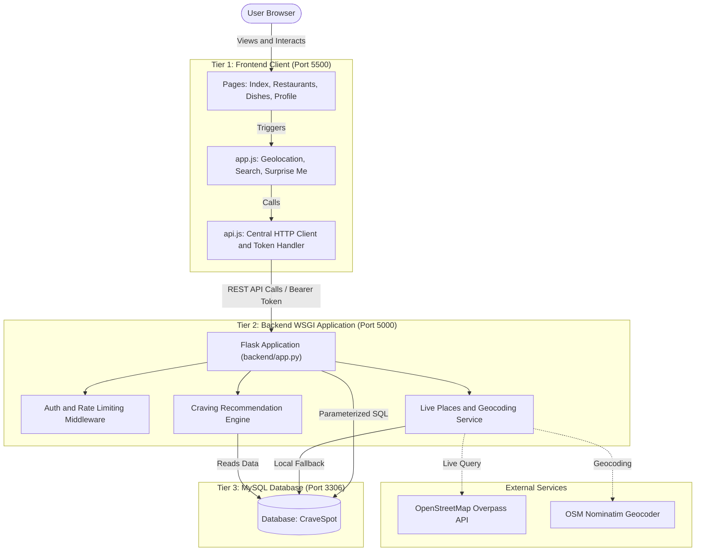

# Technical Requirements Document (TRD)

**Project:** CraveSpot — Hyper-Local Restaurant Discovery & Intelligent Craving Recommendation Engine  
**Version:** 2.0 (Production Release)  
**Date:** November 2026  
**Status:** APPROVED  
**BRD Reference:** BRD v2.0  
**Team:** The Confluence  

---

## 1. System Overview

CraveSpot implements a decoupled 3-tier client-server architecture:
- **Presentation Tier:** Static single-page application (SPA) built with HTML5, CSS3, and vanilla JavaScript (ES6+), communicating with backend REST endpoints via `fetch()`.
- **Application Tier:** Python Flask 3.1 WSGI application handling validation, rate limiting, craving scoring, and geolocation logic.
- **Data Tier:** MySQL 8.0 relational database containing 15 normalized tables adhering to Boyce-Codd and Third Normal Form (3NF).

---

## 2. Architecture Diagram

---

## 3. Technology Stack & Runtime Specifications

| Layer | Component | Version | Role |
|---|---|---|---|
| Frontend | HTML5 / CSS3 / ES6+ | HTML5 / CSS3 / ES6+ | Responsive presentation, DOM manipulation |
| Frontend | Leaflet.js | 1.9.4 | Interactive food discovery map and pin clustering |
| Backend | Python | 3.10 to 3.14 | Core server runtime environment |
| Backend | Flask | 3.1.0+ | WSGI microframework and HTTP routing |
| Backend | Flask-CORS | 5.0.0+ | Cross-Origin Resource Sharing handling |
| Backend | Werkzeug | 3.1.0+ | Scrypt password hashing and security utilities |
| Backend | itsdangerous | 2.2.0+ | Cryptographic token signing for stateless auth |
| Backend | mysql-connector-python | 9.0.0+ | Connection pooling and dictionary cursors |
| Database | MySQL Server | 8.0+ | Relational data persistence and spatial indexing |
| Testing | Pytest & Unittest | 8.0+ | Automated regression testing (262 assertions) |

---

## 4. Database Schema Specifications

The database schema (`database/schema.sql`) contains 15 tables and views in strict 3NF:
1. `users` (User credentials, hashed passwords, roles)
2. `user_profiles` (Avatars, addresses, bios)
3. `user_preferences` (Dietary choices, spice tolerance, budgets)
4. `food_categories` (Master categories with icons and images)
5. `categories` (Compatibility view)
6. `cuisines` (Regional culinary taxonomy)
7. `cravings` (Sensory tags: spicy, cheesy, sweet, crispy)
8. `restaurants` (Partner listings, ratings, price tiers)
9. `restaurant_locations` (Coordinates, city, area, pincode)
10. `restaurant_cuisines` (Many-to-many junction)
11. `food_items` (Dishes, pricing, authentic imagery)
12. `menu_items` (Compatibility view)
13. `dish_cravings` (Many-to-many junction with weight scores)
14. `favorites` (User bookmarks with cascade deletion)
15. `reviews` (Customer ratings and comments)

---

## 5. Security & Reliability Architecture

1. **SQL Injection Prevention:** Every query uses `cursor.execute(sql, (params,))` with parameterized inputs. Raw string interpolation (`%` or `f"{}"`) is strictly prohibited.
2. **Session Security:** Bearer tokens are cryptographically signed using an application secret key. Tokens are decoded and verified on every mutating API route.
3. **HTTP Security Headers:** Every HTTP response includes `X-Content-Type-Options: nosniff`, `X-Frame-Options: SAMEORIGIN`, and `X-XSS-Protection: 1; mode=block`.
4. **Resilience & Mirror Failover:** External map queries use multi-mirror fallover (`overpass.kumi.systems`, `maps.mail.ru`) with 1.8s timeouts, automatically falling back to local database entries if network drops occur.
