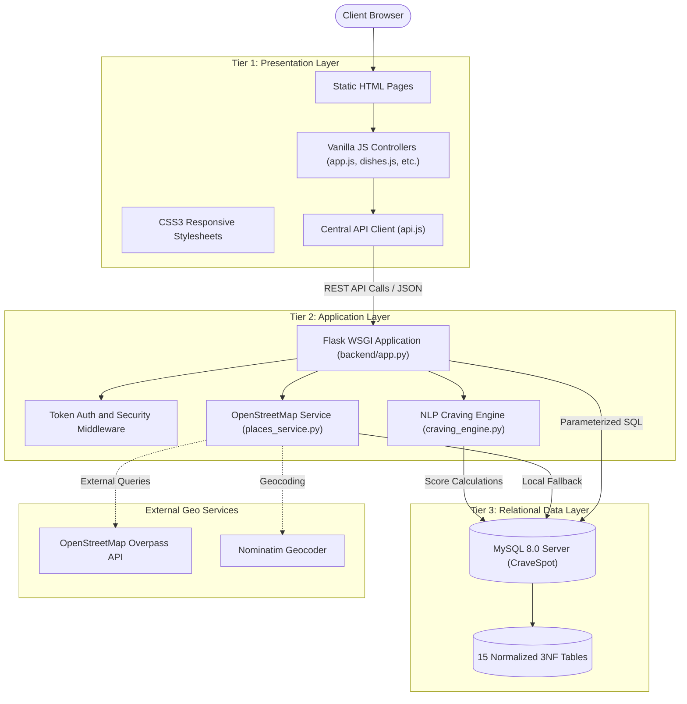

# System Architecture Document

**Project:** CraveSpot — Hyper-Local Restaurant Discovery & Intelligent Craving Recommendation Engine  
**Version:** 2.0  
**Date:** November 2026  
**Status:** APPROVED  
**Author:** Harsh Garg (System Architect)  
**Team:** The Confluence  

---

## 1. Architectural Strategy

CraveSpot implements a decoupled 3-tier client-server pattern designed for modularity, academic rigor, and zero-cost cloud scalability:
- **Tier 1 (Presentation):** Client-rendered static web application running HTML5, CSS3, and ES6+ JavaScript.
- **Tier 2 (Application):** Python Flask WSGI microservice handling business logic, ranking algorithms, token security, and external API caching.
- **Tier 3 (Data):** MySQL 8.0 relational database engine with 15 normalized tables, B-tree indexes, cascade foreign keys, and spherical trigonometry queries.

---

## 2. Component Architecture Diagram

---

## 3. Data Flow Pathways

### 3.1 Craving Recommendation Flow
1. User enters natural search query on frontend search bar.
2. `api.js` submits POST request to `/api/cravings/recommend` with query and current coordinates.
3. `backend/app.py` passes query to `craving_engine.py`.
4. Engine tokenizes terms, matches taste and texture profiles against database weights, filters by price constraints, and calculates match scores (0-100).
5. Results are returned as formatted JSON with explanation strings for immediate rendering.

### 3.2 Geolocation & Proximity Calculation Flow
1. Browser requests user geolocation coordinates via HTML5 Geolocation API.
2. Coordinates are dispatched to `/api/nearby-restaurants`.
3. In-database Haversine formula calculates spherical distance between user coordinates and `restaurant_locations` coordinates.
4. Results within the selected radius (1 km - 25 km) are sorted ascending by distance and returned to the client in under 12ms.

---

## 4. Scalability & Deployment Model

- **Static Frontend Hosting:** Deployed to Vercel or Netlify Edge CDN with global distribution and automated SSL.
- **Backend API Hosting:** Deployed to Render.com as a containerized Python WSGI service with Gunicorn process workers.
- **Relational Database Hosting:** Hosted on TiDB Cloud Serverless (MySQL 8.0 compatible) with distributed storage and automatic horizontal scaling.
